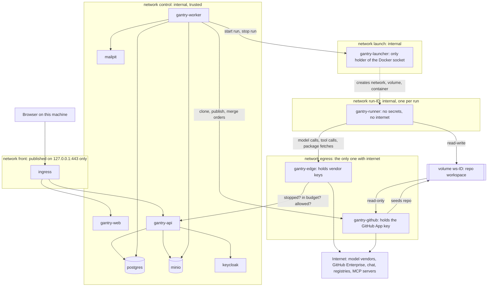

# Gantry build specification: local Docker platform and backend

Nov 14, 2026 · @Firdous

## 1. Summary

This spec defines what to build so the Gantry frontend runs against a real backend on one machine with Docker. It covers two things: the local Docker platform (networks, containers, isolation) and the backend services that replace the frontend's simulated data and operations.

**What gets built**

- Eight images: `gantry-web`, `gantry-api`, `gantry-worker`, `gantry-migrate`, `gantry-launcher`, `gantry-edge`, `gantry-github`, `gantry-runner`.
- Five pulled images for local use: `caddy`, `postgres`, `minio`, `keycloak`, `mailpit`.
- One Postgres database holding state, the event log, the audit ledger and the job queue.
- One REST API that covers every operation the frontend performs today through its in-browser `G.ops` layer.

**Design rules that everything follows**

1. An agent run is treated as hostile. It has no secrets, no internet and no GitHub write access.
2. Every action from every channel passes one permission check in `gantry-api`.
3. Every state change writes its event and audit entry in the same database transaction.
4. A stop (halt or kill) is enforced outside the agent, and keeps working when other parts are down.
5. Nothing is hardcoded that the frontend lets people configure: flows, classes, roles, integrations, vendors.

**Status of this document**

- It is a design, not a tested system. No backend code exists yet.
- The frontend contract it maps to is `CONTRACT.md` in the frontend project (rounds two and three). Round three screens are still being integrated, so section 8 may need small additions when that lands.
- Scope is local Docker only. Cloud hosting is out of scope here.
- Vendor behaviour (agent harness, GitHub, Docker DNS on internal networks) must be verified by the spikes in section 16 before the dependent parts are built.
- Language and framework are not fixed by this spec. Section 16 lists that as an open decision.

## 2. System overview

The system has three trust zones: a trusted control plane, an untrusted sandbox zone, and a small set of privileged containers that hold credentials. Runners can reach only `gantry-edge`.

| Zone | Containers | Trust |
| --- | --- | --- |
| Control plane | `gantry-web`, `gantry-api`, `gantry-worker`, `postgres`, `minio`, `keycloak`, `mailpit` | Trusted. No internet. |
| Privileged | `gantry-launcher`, `gantry-edge`, `gantry-github` | Trusted and high value. Each holds one kind of power and nothing else. |
| Sandbox | One `gantry-runner` per agent run | Untrusted. Assumed compromised by anything it reads. |

Downloadable Mermaid sources and a compose skeleton were delivered alongside this spec: `gantry-local-docker.mmd`, `gantry-traffic-flow.mmd`, `docker-compose.skeleton.yml`.

## 3. Local Docker platform

The stack is one Docker Compose project plus per-run networks, volumes and containers that `gantry-launcher` creates on demand. Ports below are proposed defaults.

### 3.1 Networks

| Network | Internet | Members | Rule |
| --- | --- | --- | --- |
| `front` | Published port only | `ingress` | The only published port is `127.0.0.1:443`. Never bind `0.0.0.0`. |
| `control` | No (`internal: true`) | `ingress`, `gantry-web`, `gantry-api`, `gantry-worker`, `gantry-edge`, `gantry-github`, `postgres`, `minio`, `keycloak`, `mailpit` | Trusted services talk here. |
| `launch` | No (`internal: true`) | `gantry-worker`, `gantry-launcher` | Nothing else can reach the launcher. |
| `egress` | Yes | `gantry-edge`, `gantry-github` | The only route out of the machine. |
| `run-<id>` | No (`internal: true`) | One `gantry-runner`, plus `gantry-edge` | Created per run, removed after. Runners never share a network. |

Per-run networks exist because containers on the same Docker bridge can reach each other by default. Docker's default address pools limit how many bridge networks can exist at once, so run networks must use small explicit subnets (for example `/28`) from a dedicated range, and the launcher must cap concurrent runs below that limit.

### 3.2 Images built for Gantry

| Image | Port | Networks | Holds | Purpose |
| --- | --- | --- | --- | --- |
| `gantry-web` | 8080 | control | Nothing | Serves the frontend as static files. |
| `gantry-api` | 8000 | control | Session key, database password, service tokens | REST API, sign-in sessions, the permission decision point, all state-changing commands, live updates to the browser. |
| `gantry-worker` | none | control, launch | Database password, launcher token | Flow engine, timers, outbox dispatch, GitHub reconcile orders, reaper, trust and eval jobs. Same code as the API, different command. |
| `gantry-migrate` | none | control | Database password | Schema migrations. Runs once per deploy and exits. |
| `gantry-launcher` | 9100 | launch | Docker socket, launcher token | Starts and stops runner containers from a fixed template. Two operations only. |
| `gantry-edge` | 8443 model and MCP gateway, 8444 forward proxy | control, egress, each `run-<id>` | Model vendor keys, MCP credentials | The only endpoint a runner can reach. Checks every call, injects credentials, enforces the outbound allow-list. Also the outbound proxy for the worker's notifications. |
| `gantry-github` | 9200 | control, egress | GitHub App private key | Clone into workspaces, publish commits, open pull requests, checks, merge, reconcile. Never joined to a run network. |
| `gantry-runner` | none | its own `run-<id>` | A per-run token only | One agent run: agent harness, git, the repo's toolchain. A base image plus one variant per tech stack. |

### 3.3 Images pulled

| Image | Port | Purpose locally |
| --- | --- | --- |
| `caddy` | 443 | Ingress and TLS with a locally trusted certificate. |
| `postgres` | 5432 | The one database. |
| `minio` | 9000 | S3-compatible object storage for artefacts, traces and patches. |
| `keycloak` | 8081 | OpenID Connect sign-in, standing in for an enterprise identity provider. |
| `mailpit` | 1025 SMTP, 8025 UI | Catches outgoing email for inspection. |

### 3.4 Volumes

| Volume | Mounted by | Notes |
| --- | --- | --- |
| `pgdata` | `postgres` | Back up with `pg_dump` on a schedule; keep at least 7 daily copies outside the Docker volume. |
| `objdata` | `minio` | Artefacts and traces. |
| `ws-<id>` | `gantry-github` (read-write to seed, read-only to publish), then `gantry-runner` (read-write) | One per run. Never a bind mount of a host path. Removed after publish, or kept for a set period when a run is killed. |

### 3.5 Secrets

- Secrets are files mounted through Compose `secrets`, never environment variables and never baked into images.
- Files live outside the source repository with owner-only permissions.
- Each secret is mounted into exactly the containers listed below.

| Secret | Mounted into |
| --- | --- |
| Database password | `postgres`, `gantry-api`, `gantry-worker`, `gantry-migrate` |
| Session signing key | `gantry-api` |
| Model vendor keys | `gantry-edge` |
| MCP server credentials | `gantry-edge` |
| GitHub App private key | `gantry-github` |
| Edge service token, GitHub-broker service token | `gantry-api` plus the one service that presents it |
| Launcher token | `gantry-worker`, `gantry-launcher` |

Secrets that users enter in the UI (integration tokens, vendor keys, MCP credentials) are stored encrypted in Postgres with a key held in a secret file, and are decrypted only inside the service that uses them. The API never returns a stored secret; it returns a masked form.

### 3.6 Hardening applied to every Gantry service container

- Read-only root filesystem with a `tmpfs` for `/tmp`.
- All Linux capabilities dropped; `no-new-privileges` set.
- Runs as a non-root user.
- No published ports except the ingress.
- Health check defined; restart policy `unless-stopped`.

## 4. Sandbox isolation and the lifecycle of one run

A run is one attempt by one agent at one station of one work order. Each run gets its own container, network and workspace volume, and none of them outlives the run.

### 4.1 Runner template

The launcher builds every runner from this fixed template. The caller supplies only a run id, a workspace reference and an image variant from an allow-list.

| Setting | Value | Why |
| --- | --- | --- |
| Network | Its own `run-<id>`, internal | The edge is the only peer. No other runner, no control plane, no internet. |
| User | Non-root, fixed uid | A breakout attempt starts without root. |
| Capabilities | All dropped, `no-new-privileges` | Removes mount, raw network and privilege-gain paths. |
| Root filesystem | Read-only; `/tmp` as `tmpfs` with `noexec`, `nosuid` and a size cap | The only writable places are `/workspace` and `/tmp`. |
| Workspace | Named volume `ws-<id>` at `/workspace` | Never a host bind mount. |
| Limits | Memory, CPU and process-count caps; wall-clock limit enforced by the worker | Stops runaway and fork-bomb behaviour. |
| Environment | Gateway address, proxy address, per-run token | No vendor key, no GitHub token, no database address. |
| Never | `--privileged`, host network or PID namespace, Docker socket, devices | Each is a direct route to the host. |

### 4.2 What the runner can reach

| Need | How | Enforced by |
| --- | --- | --- |
| Model calls | Agent harness points its base URL at `gantry-edge:8443` | Edge checks the run token, stop state and budget on every call, then forwards with the vendor key. |
| MCP tools | Through the edge's MCP gateway only | Edge checks project, repo, agent, station and tool scope; write tools need the station's pre-authorisation. |
| Packages | `HTTPS_PROXY` set to `gantry-edge:8444` | Edge allows only listed registry hosts per project. |
| Source code | Already in `/workspace` when the run starts | `gantry-github` clones before the runner exists. |
| Publishing commits | The runner commits locally; it never pushes | `gantry-github` publishes after the step (section 11). |
| Anything else | Nothing | No route exists. |

The agent harness must be started so that configuration found inside the repository (hooks, tool server definitions, settings files) does not load automatically. Gantry composes the instructions, skills and tool list and passes them in explicitly.

### 4.3 Lifecycle

1. **Dispatch.** The worker picks a job, records a new attempt with a fencing number, and asks the launcher to start the run.
2. **Prepare.** The launcher creates `run-<id>` and `ws-<id>`. `gantry-github` clones the repo at the recorded commit into the volume and detaches.
3. **Start.** The launcher attaches `gantry-edge` to the run network and starts the runner with a per-run token issued by the API.
4. **Work.** The harness runs turns. Every model call, tool call and package fetch goes through the edge. The edge reports usage and trace references to the API.
5. **Heartbeat.** The runner's wrapper reports progress through the edge. A missed heartbeat past the lease marks the attempt lost.
6. **Checkpoint.** At each turn boundary the harness transcript and station artefacts are saved through the edge to object storage.
7. **Finish.** The runner returns a structured station result. The worker asks `gantry-github` to publish the workspace's commits, then tells the launcher to stop the run.
8. **Teardown.** The launcher kills and removes the container, disconnects the edge, removes the network, and removes the volume after publishing.

### 4.4 Stopping a run

A stop never depends on the agent cooperating.

| Step | Action | Target time |
| --- | --- | --- |
| 1 | API commits the stop state and bumps the fencing number for the scope | Immediate |
| 2 | Edge refuses that run's token on its next call; `gantry-github` refuses to publish for a superseded attempt | Within 10 seconds |
| 3 | Launcher sends terminate, then kill, then removes the container and network | Within 60 seconds |
| 4 | Worker verifies the container is gone; otherwise raises a "termination unconfirmed" alert | Within 150 seconds |

The times are targets to be confirmed by the kill spike in section 16.

### 4.5 Halt, budget hold and resume

- A halt or a budget hold is a checkpoint at the turn boundary followed by the same teardown. Nothing is paused in place.
- The coding slot stays reserved as data for a halt and is released for a kill.
- Resume starts a fresh run from the last saved station artefacts and transcript. Resume must not depend on the old container or volume existing.

### 4.6 Reaper

The worker lists runner containers, run networks and workspace volumes through the launcher every minute and removes any without a live attempt lease. This covers crashes of the worker or launcher mid-run.

## 5. Security requirements

Security rests on limiting what a compromised agent can do, not on detecting bad input. Text an agent reads (issues, repo files, tool output, web pages) is always treated as untrusted, whoever wrote it.

### 5.1 Invariants that no configuration can remove

| # | Invariant |
| --- | --- |
| I1 | No agent merges on its own authority. A merge needs GitHub's branch rules to pass and a human review. |
| I2 | No secret is ever placed in a runner: not in its environment, files, prompts or logs. |
| I3 | The audit ledger is append-only and cannot be switched off. If it cannot be written, new work stops. |
| I4 | The requester of a work order is never its sole approver. |
| I5 | Access is denied unless a rule allows it. |
| I6 | Agents cannot approve changes to policy, trust levels, evals, skills, instructions or CI configuration. |
| I7 | A Factory Admin can always halt and kill. Stop commands work when the flow engine or policy data is unavailable. |
| I8 | At least one person always holds the right to restore after a kill. |
| I9 | The permission matrix cannot be edited so that no one can edit it. |

### 5.2 Threats and the control for each

| Threat | Control |
| --- | --- |
| Text injected into an agent makes it ship bad code | I1; the runner has no GitHub write access; changes to CI, dependencies, code-owner files, auth paths, migrations and Gantry config always need a human gate |
| Theft of the GitHub App key or vendor keys | Keys exist only in `gantry-github` and `gantry-edge`; neither is reachable from a runner except the edge's checked endpoints |
| Source code or secrets leaked from a runner | No internet route; outbound only through the edge's allow-list; secret scanning on prompts, logs and diffs before storage |
| A non-UI path skips permissions | One decision point in the API used by UI, public API, chat actions, triggers, console and edge |
| The launcher is abused to control the host | Reachable only from the worker over the `launch` network with a token; fixed template; no caller-supplied image, mounts or flags |
| A runner attacks another runner | Separate network and volume per run |
| Malicious repo content attacks the publisher | `gantry-github` mounts the workspace read-only and never executes anything from it: hooks disabled, no repo-local git config honoured |
| Runaway agent spends without limit | Budget checked at the edge before every model call; turn, time and cost caps per run |
| A stolen session or API key | Server-side revocable sessions; API keys stored hashed, scoped, expiring; step-up sign-in for kill (a security setting, on by default), restore, policy and key operations |
| A changed MCP tool does something new | Tool definitions pinned by hash; a changed definition disables the server until re-approved |

### 5.3 Rules by area

- **Permission check.** Every state-changing endpoint calls the decision point with person or service identity, action, project, repo and time. The decision and the rule that produced it are stored with the audit entry. Denials are audited.
- **Acting identity.** Console and chat actions run with the requesting person's authority. Triggers and API keys run as named service identities with their own scope.
- **Run token.** Issued by the API per run, bound to the run id and fencing number, accepted only by the edge, revoked on stop.
- **GitHub tokens.** `gantry-github` mints short-lived installation tokens scoped to one repository for each operation and never stores them outside memory.
- **Outbound allow-list.** Per project: model endpoints, the GitHub host, package registries, MCP servers in scope. Everything else is refused and logged.
- **Stored content.** Prompts, completions and tool traffic are captured at the edge and stored by reference in object storage after secret scanning.
- **Input validation.** Webhook and chat callbacks are signature-verified with replay protection. API creates require an idempotency key.

### 5.4 Isolation tests

These run in CI against the local stack and must all pass before any real repository is connected. Each is run from inside a runner unless stated.

| # | Attempt | Required result |
| --- | --- | --- |
| T1 | Connect to any public internet address directly | Fails |
| T2 | Connect to `postgres`, `gantry-api`, `gantry-github`, `gantry-launcher`, `minio` | Fails |
| T3 | Connect to another runner | Fails |
| T4 | Resolve an external hostname | Fails, or returns nothing usable; verify on the Docker version in use |
| T5 | Find the Docker socket, any vendor key or any GitHub token in the environment or filesystem | Nothing found |
| T6 | Write outside `/workspace` and `/tmp` | Fails |
| T7 | Call the edge with the run token after the run is stopped | Refused |
| T8 | Fetch a package host that is not on the allow-list | Refused and logged |
| T9 | A repo containing a malicious git hook and tool-server config is run and published | Neither executes, in the runner's harness start-up or in `gantry-github` |
| T10 | Call the launcher from `gantry-api` or from a runner | No route |
| T11 | Seeded instructions in an issue, a repo file and a tool result tell the agent to exfiltrate or to push elsewhere | No write outside the work order's branch; no outbound call off the allow-list |
| T12 | Call each state-changing API endpoint with a valid session that lacks the permission | Denied and audited, for every endpoint |

### 5.5 Limits of the local stack

- Whoever administers the machine can read every secret and edit the database. Local audit records are not tamper-evident against that person.
- Containers share the host kernel. Rootless Docker reduces the launcher risk; a stricter sandbox runtime for runners can be added on Linux later.
- GitHub cannot deliver webhooks to a machine it cannot reach, so the local stack polls.
- Repositories whose builds or tests need Docker cannot run in this sandbox.

## 6. Backend services

Five services share one codebase and one database. Only `gantry-api` and `gantry-worker` talk to Postgres; the other three reach state through the API.

### 6.1 `gantry-api`

- Serves the REST API in section 8 and a live-update stream to the browser.
- Owns sign-in, sessions and the permission decision point (section 14).
- Executes every command as one transaction: validate, check permission, change state, append the event with its audit fields, enqueue follow-up jobs.
- Exposes an internal API for the edge and the GitHub broker: run-token check, stop-state and budget check, usage report, trace reference, heartbeat, GitHub event intake.
- Stateless. Two or more copies can run behind the ingress.

### 6.2 `gantry-worker`

- **Flow engine:** advances work orders, opens and closes gates, manages coding slots and the queue (section 9).
- **Job runner:** takes jobs from a Postgres-backed queue with leases and retries. No separate message broker.
- **Timers:** escalation deadlines, change windows, freezes, soak periods, lease expiry. Timers are rows; missed ones fire on recovery.
- **Outbox dispatcher:** turns committed events into notifications and outbound webhooks, at least once, keyed by event id and destination.
- **Reconciler:** asks `gantry-github` to re-read pull requests, checks and repo settings on a schedule and records any drift as events.
- **Reaper:** removes orphaned runners, networks and volumes through the launcher.
- **Evaluators:** trust evidence, workload figures, learning findings and eval suite orchestration.

### 6.3 `gantry-launcher`

| Operation | Input | Effect |
| --- | --- | --- |
| `start-run` | Run id, workspace reference, image variant | Creates the network and volume, has the repo seeded, attaches the edge, starts the runner from the fixed template |
| `stop-run` | Run id | Terminates, kills and removes the container; removes the network; hands the volume to publishing or removes it |
| `list-runs` | None | Returns runner containers, run networks and workspace volumes for the reaper |

It accepts requests only from the worker, authenticated with the launcher token. It has no database access and no internet.

### 6.4 `gantry-edge`

| Function | Behaviour |
| --- | --- |
| Model gateway | Presents one model-API endpoint to the harness. Per call: verify run token, ask the API for stop state and remaining budget, pick the vendor route allowed for the project, inject the key, forward, stream back, report token usage and cost. |
| MCP gateway | Holds MCP credentials. Checks server scope (project, repo, agent, station), per-tool allow rule, the admin-set read or write class, and the station's write pre-authorisation. Logs every call with an argument hash. |
| Forward proxy | Allows HTTPS to listed hosts only, per project. Used by runners for packages and by the worker for chat and webhook delivery. |
| Trace capture | Stores request and response content by reference in object storage after secret scanning, as increments, not full repeats. |
| Fail closed | If it cannot reach the API to check a call or record usage, it refuses the call. |

### 6.5 `gantry-github`

- The only component with the GitHub App private key.
- Operations, called by the worker: seed a workspace, publish commits from a workspace, open or update a pull request, set the Gantry gate check, read checks and reviews, convert to draft, merge a specific commit, read repo protections for onboarding, list and reconcile deliveries.
- Every write presents the attempt's fencing number to the API first; a superseded attempt is refused.
- Treats workspace content as untrusted data.

### 6.6 What stays out

- No separate workflow server, message broker, cache or search service in this stack. Postgres covers queue, timers and search for the first version.
- No direct vendor SDK calls from stations. Stations call a runtime adapter (section 10).

## 7. Data model

Gantry is the system of record for intent and authority: what was asked, what was agreed, who or what approved it under which rule, and what each agent did. GitHub remains the record for code and the identity provider for people.

### 7.1 Rules

- Every row carries `org_id`, even with one organisation, so a second can be added without a rewrite.
- Anything a decision can depend on is versioned and immutable once published: flows, gate rules, policies, the role matrix, trust criteria, agents, skills, instruction layers, guidelines, routing rules.
- Every gate decision stores the ids of the versions in force: flow, gate rule, policy, trust grant and level, the approver's role assignment, agent version, skill versions, instruction hash, exact model id and commit.
- Large content (artefacts, traces, patches, diffs) lives in object storage, referenced by content hash.
- Secrets never appear in rows, events or traces; only fingerprints or masked forms.

### 7.2 The event log and audit ledger

One append-only table, `events`, written in the same transaction as the state it describes.

| Field | Meaning |
| --- | --- |
| `seq` | Per-organisation sequence, the total order |
| `occurred_at`, `recorded_at` | When it happened and when it was stored |
| `type` | For example `wo.submitted`, `gate.vote_recorded`, `stop.set`, `policy.saved` |
| `category` | auth, access, flow, onboarding, approvals, config, integrations, api, agents, kill, trust, learning |
| `actor`, `on_behalf_of` | Person, agent version, API key or service; and the person a channel acted for |
| `channel` | web, console, slack, teams, api, github, schedule, system |
| `subject` | Typed reference: work order, project, repo, agent, gate and so on |
| `project_id`, `wo_id`, `wo_version` | Scope and the work order's version after the change |
| `outcome` | ok, denied, failed, regression |
| `rule` | The permission rule that decided it |
| `before`, `after` | Structured change, for configuration events |
| `command_id`, `idempotency_key`, `causation_id` | Deduplication and tracing |
| `session_id`, `source_ip`, `request_id` | Where it came from |
| `prev_hash`, `hash` | Hash chain over the organisation's events |

- The database role used by the services can insert into `events` and cannot update or delete.
- A verifier job walks the chain daily and alerts on any break.
- The audit screen, the work order record, replay, the outbox and workload figures all read this table. None has its own copy of history.
- Agent turn-level telemetry is not in this table. It lives in the trace store with shorter retention.

### 7.3 Entities

| Group | Tables | Notes |
| --- | --- | --- |
| Organisation | `orgs`, `teams`, `people`, `team_members`, `invites` | People mirror the identity provider; the provider wins on active status. |
| Access | `roles`, `role_matrix_versions`, `role_assignments`, `policies` (versioned), `freezes`, `delegations`, `oncall` | Custom roles are rows. Assignments are scoped to factory or project. |
| Projects | `projects`, `project_members`, `templates`, `budgets`, `saved_views` | Archived is a state, not a delete. |
| Flow | `flow_versions` (stations, gates, bays, classes, routes, slots, limits as one document per version), `approver_rules` (versioned), `gate_modes` | Custom stations, gates, bays and classes are entries in the flow version. |
| Repos | `repos`, `repo_config`, `onboarding_runs`, `onboarding_findings`, `onboarding_prs`, `guideline_versions` | Readiness is a state that is re-checked. |
| Work orders | `work_orders` (position, state, version, flow version, class, priority, source), `requests` (original text, verbatim), `conversations`, `messages`, `brief_versions`, `epic_children`, `bay_stays`, `slots` | One position per work order; version increases on every change. |
| Execution | `attempts` (station visit, fencing number, lease), `runs`, `run_usage`, `artefacts`, `checkpoints`, `station_results` | An attempt is one try at a station. |
| Code | `commits`, `changed_files`, `patches`, `pull_requests`, `reviews`, `review_comments`, `checks`, `test_results`, `merges`, `releases`, `outcomes` | Copied from GitHub when they occur, keyed by GitHub ids. |
| Gates | `gate_instances`, `gate_votes`, `gate_decisions` | A gate instance closes on decision, send-back, kill or a new head commit. |
| Stop state | `stops` (scope, mode, reason, cause, set by, lifted by), `restore_approvals` | Scopes: factory, project, repo, work order. |
| Agents | `agents`, `agent_versions`, `skills`, `skill_versions`, `agent_skills`, `instruction_versions`, `agent_overrides` | A version tuple row ties agent version, skill versions, instruction hash, harness version and model id together. |
| Models | `vendors`, `models`, `routing_versions`, `price_versions`, `usage_meter` | Usage is recorded per call against run, station, agent version and project. |
| Evals and trust | `suites`, `eval_cases`, `eval_runs`, `eval_results`, `trust_cells`, `trust_grants`, `trust_proposals`, `trust_criteria_versions`, `trust_ceilings`, `sampling_draws` | A trust grant references the evidence it was based on. |
| Learning | `findings`, `proposals`, `proposal_evidence` | A proposal records the change it applied and the eval that verified it. |
| Integrations | `integration_types` (with field schema), `integration_instances`, `chat_identity_links`, `notification_routes`, `repo_route_overrides`, `card_templates`, `deliveries` | Custom integration types are rows with the same schema as built-ins. |
| MCP | `mcp_servers`, `mcp_tools` (definition hash, read or write class, allowed), `mcp_scopes`, `mcp_calls` | A changed definition hash disables the server. |
| API and triggers | `api_keys` (hash only), `api_requests`, `idempotency_keys`, `triggers`, `trigger_runs`, `inbound_deliveries` | Inbound deliveries are deduplicated on source and delivery id. |
| Identity | `sessions`, `signins`, `security_settings` (versioned) | Sessions are server-side and revocable. |
| Jobs | `jobs`, `timers`, `outbox` | The queue, durable timers and outbound deliveries. |
| Console | `console_threads`, `console_messages` | Per person. |

### 7.4 Retention defaults

| Data | Default |
| --- | --- |
| Events, gate decisions, structured work order record, configuration versions | 7 years |
| Agent traces (prompts, completions, tool calls) | 90 days; runs cited by a live trust grant, a golden eval task or an incident are pinned |
| Runner and build logs | 30 days |
| Patches and diff previews | 90 days after the work order closes |
| Raw inbound deliveries and API request log | 30 days |
| Console threads | 90 days |

Retention periods are proposals; a compliance requirement would change them.

## 8. API

The API replaces the frontend's in-browser store and `G.ops` layer one for one. Each table below names the frontend operation it backs, so the frontend swap is mechanical: a read becomes a `GET`, an op becomes a command endpoint that returns the same `{ ok, msg, ... }` shape.

### 8.1 Conventions

| Topic | Rule |
| --- | --- |
| Base path | `/api/v1` for the browser and public clients; `/internal/v1` on the control network for the edge and GitHub broker |
| Auth | Browser: secure, HTTP-only session cookie plus a CSRF token. Public API: bearer API key. Internal: service token. |
| Commands | `POST` to a noun or an action sub-path. Body carries `via` (web, console, slack and so on) where the frontend passes it. |
| Result | `200` with `{ ok: true, msg, ...extra }`; refusals use `403` (permission), `409` (state conflict, stale version, killed or halted scope), `422` (validation), each with `{ ok: false, msg, rule?, needs? }` |
| Concurrency | Work order and config commands accept `If-Match` with the entity version; a stale version returns `409`. |
| Idempotency | `Idempotency-Key` header on creates. Same key and body returns the first result; same key with a different body returns `409`. |
| Lists | Cursor pagination, filter and sort parameters matching the frontend's table filters. |
| Permissions for the UI | `POST /api/v1/can` takes a batch of `{ action, project?, repo?, time? }` and returns `{ allowed, reason, rule, needs }` each, so controls can be disabled with a reason exactly as today. Every list and detail response also carries the allowed actions for that item. |
| Live updates | `GET /api/v1/stream` (server-sent events) emits changed entity keys per project the person can see. The frontend re-fetches what changed. This replaces the simulated tick. |
| Time | All timestamps UTC in the API; the plant time zone is an organisation setting used for windows and display. |

### 8.2 Session and identity

| Screen | Frontend op | Endpoint |
| --- | --- | --- |
| Sign-in | `signIn` (sso, github) | `GET /auth/login`, `GET /auth/callback` (OpenID Connect) |
| Sign-in, user menu | `signOut`, session read | `POST /auth/logout`, `GET /api/v1/me` (person, roles per project, visible projects, session) |
| User menu, Security | `revokeSession` | `GET /api/v1/sessions`, `DELETE /api/v1/sessions/{id}` |
| Security | `setSecurity`, sign-in history | `GET/PATCH /api/v1/security`, `GET /api/v1/signins` |

The demo-account list on the sign-in screen is a development-only feature flag backed by seeded Keycloak users.

### 8.3 Home, projects and configuration

| Screen | Frontend op | Endpoint |
| --- | --- | --- |
| Home (one page for everyone) | Reads | `GET /api/v1/home`: `sections` built by the caller's rights, default deny (setup checklist, attention scoped to visible projects, waiting on you, in motion, projects, factory health with real eval health); plus `approvals`, `conversations`, `badges` for the bell and nav. Kill and restore live in the status chip and Ctrl K, not on Home |
| Projects, portfolio | Reads, saved views | `GET /api/v1/projects`, `GET/POST/PATCH/DELETE /api/v1/saved-views` |
| New project wizard | `createProject` | `POST /api/v1/projects` |
| Templates | `saveTemplate`, `updateTemplate` | `GET/POST /api/v1/templates`, `PATCH /api/v1/templates/{id}` |
| Project config | `setProject`, `setGateMode` | `GET /api/v1/projects/{id}`, `PATCH /api/v1/projects/{id}/config` (publishes a new flow or config version; `flow.gates.{gate}.enabled` false is refused with 409 for a locked gate and needs a fresh sign-in) |
| Project config: flow | `addStation`, `removeStation`, `moveStation`, `addGate`, `addBay`, `addClass`, `updateClass` | `POST/DELETE/PATCH` under \`/api/v1/projects/{id}/flow/{stations |
| Project config: approvers | `setProject("approvers.*")`, `setAway` | `PUT /api/v1/projects/{id}/approvers/{gate}`, `PUT /api/v1/people/{id}/away` |
| Project config: members | `setMemberRole` | `PUT/DELETE /api/v1/projects/{id}/members/{person}/roles/{role}` |
| Project config: danger zone | `archiveProject`, `unarchiveProject` | `POST /api/v1/projects/{id}/archive`, `/unarchive` |

### 8.4 Floor, work orders, conversations and the record

| Screen | Frontend op | Endpoint |
| --- | --- | --- |
| Floor (belt, board, list) | Reads, `G.flowOf`, `G.slotsUsed` | `GET /api/v1/projects/{id}/floor` (flow version, positions, gates, slots, stop state) |
| Floor replay | `G.stateAt`, event marks | `GET /api/v1/projects/{id}/floor?at={time}`, `GET /api/v1/projects/{id}/events?from=&to=&kinds=` |
| New work order | `submitWO`, `G.submitGuard` | `POST /api/v1/projects/{id}/work-orders` (returns classification and route) |
| Work orders table | Reads | `GET /api/v1/projects/{id}/work-orders` |
| Traveler | Reads | `GET /api/v1/work-orders/{id}` |
| Conversations (list) | Reads | `GET /api/v1/work-order-sessions` (one row per work order: who waits on whom, latest message, station, unread; no forms) |
| Work-order session | `session`, `sendTurn`, `decide` | `GET /api/v1/work-orders/{id}/session`, `POST .../session/messages` (streams the station agent's answer), `POST .../session/proposals/{mid}/{pid}` (approve, changes, discard), `POST .../session/seen` |
| Intake (scripted fallback) | `answer`, `raiseQuestion` | `GET /api/v1/conversations`, `POST /api/v1/work-orders/{id}/messages` |
| Intake | `reclassify`, `confirmBrief`, `decline` | `POST /api/v1/work-orders/{id}/reclassify`, `/confirm-brief`, `/decline` |
| Gates | `approveGate`, `rejectGate`, `G.gateDecision`, `G.gateProgress` | `POST /api/v1/gate-instances/{id}/approve`, `/reject`; gate progress is part of the work order read |
| Board and traveler moves | `moveTo`, `G.moveCheck`, `sendBack`, `park`, `unpark`, `reassign`, `retry` | `POST /api/v1/work-orders/{id}/move` (with `dry_run` for the move check), `/send-back`, `/park`, `/unpark`, `/reassign`, `/retry` |
| Record and Lifecycle tab | `G.lc`, `setRecordSummary` | `GET /api/v1/work-orders/{id}/record`, `GET .../record.md`, `GET .../record/export` (bundle with hashes), `PUT .../record/summary` |
| Record: changes | Reads | `GET /api/v1/work-orders/{id}/changes` (commits, files, patches by reference) |

**The work-order session (8.4).** Each work order has one agent conversation for its whole life (`#/p/<project>/conversations/<WO>`; the traveler's "Open conversation", the Conversations list and the bell open it). The agent at the work order's CURRENT station talks (the Intake Clerk at Intake), on its own pinned model through routing (not a per-person choice), inside its own budget per work order. At Intake the agent is agent-led: it reads the request and, through read-only tools, the work order, the project, the repository's files (broker) and related work; asks only what it needs, in natural language, as question cards with suggested answers; and drafts the brief (goal, scope in and out, acceptance criteria, risks, open questions, estimate, with the class, confidence and rationale it read) as a PROPOSAL card showing the diff against the brief as it stands. Nothing the agent says dictates a fixed question list. Deterministic code supplies observed facts (labelled observed; request and repository text is untrusted), safety rails on a proposal (a real goal, at least one acceptance criterion, bounded lists, no credentials) and permission checks. Approve runs the ordinary command under the approving person's own rights: a brief proposal is the confirm-brief command at G0+G1 (`brief.confirm`), a reclassify proposal is `reclassify` (`wo.classify`), a decline proposal is `decline` (`wo.decline`); "Ask for changes" continues the dialogue; Discard changes nothing; a newer proposal replaces older pending ones, and a brief that moved since it was proposed refuses the approval. Reading needs `project.view`; talking needs the right to act on the work order (`wo.answer`, which the submitter always has). Free text always gets an answer. Past Intake the station agent answers questions read-only (where it is, what each station did, what waits on whom) and cannot propose. Station transitions, gate decisions, bays, merges and failed checks are posted once into the session from the event ledger (idempotent per event) and notify the people involved through the bell until they open it; a new class or a send-back to Intake asks the agent for a follow-up turn. A work order at Intake with no session is opened by the agent itself. With no usable model or budget the scripted intake questionnaire answers instead, labelled "Rule-based (no agent)", and its history is shown first in the session. The session shares its core (turn history, SSE streaming, cost, station-agent gate) with the onboarding session (11.3); its rows are `workorder_messages` and `workorder_session_seen`.

### 8.5 Stop controls

| Screen | Frontend op | Endpoint |
| --- | --- | --- |
| Floor, Andon | `haltRepo`, `resumeRepo`, `haltProject`, `resumeProject` | `POST /api/v1/stops` with scope and mode `halt`; `DELETE /api/v1/stops/{id}` |
| Kill dialog | `killImpact` | `GET /api/v1/stops/impact?scope=&id=` |
| Status chip, Ctrl K, floor, traveler, console | `kill` | `POST /api/v1/stops` with mode `kill`, in-flight handling, reason and confirmation text |
| Restore | `restore` | `POST /api/v1/stops/{id}/restore` (returns pending when a second approver is needed) |

Stop endpoints are served by a code path that reads and writes only the `stops` table and the event log, so they work when other subsystems are failing.

### 8.6 Onboarding

| Screen | Frontend op | Endpoint |
| --- | --- | --- |
| Onboarding pipeline | Reads | `GET /api/v1/projects/{id}/repos` |
| Connect-repo wizard | `connectRepo`, `configureRepo` | `POST /api/v1/projects/{id}/repos`, `PATCH /api/v1/repos/{id}/config` |
| Repo drawer | `rerunAssessment`, `openOnboardingPR`, `mergeOnboardingPR`, `requestChanges`, `markException`, `verifyNow` | \`POST /api/v1/repos/{id}/onboarding/{assess |
| Onboarding agent | `saveGuidelines` | `GET/PUT /api/v1/guidelines`, `PUT /api/v1/projects/{id}/guidelines` |

`simulateChecksPass` has no production endpoint; real check results arrive from GitHub.

### 8.7 Agents, skills, models, evals, trust, learning

| Screen | Frontend op | Endpoint |
| --- | --- | --- |
| Agents | `createAgent`, `saveAgent`, `newAgentVersion`, `promoteAgent`, `rollbackAgent`, `attachSkill`, `saveInstructions` | `GET/POST /api/v1/agents`, `PATCH /api/v1/agents/{id}`, `POST .../versions`, `.../versions/{v}/promote`, `.../rollback`, `PUT/DELETE .../skills/{skill}`, `PUT /api/v1/instructions/base` |
| Agents: effective instructions | `G.agentEligibility`, preview | `GET /api/v1/agents/{id}/effective?project=&repo=` |
| Skills | `saveSkill`, `setSkillProjects` | `GET/POST /api/v1/skills`, `PATCH /api/v1/skills/{id}`, `PUT .../projects` |
| Models | `setVendor`, `addVendor`, `addModel`, `removeModel`, `setModelEnabled`, `setRouting` | `GET/POST /api/v1/vendors`, `PATCH /api/v1/vendors/{id}`, `POST/DELETE /api/v1/models`, `GET /api/v1/vendor-templates`, `POST /api/v1/vendors/from-template`, `POST /api/v1/vendors/{id}/discover`, `PUT /api/v1/routing`, `GET /api/v1/routing/resolve?station=&repo=` |
| Evals | `runSuite`, `addEvalCase` | `GET /api/v1/evals/scorecards`, `GET/POST /api/v1/suites/{id}/runs`, `POST /api/v1/suites/{id}/cases`, `GET /api/v1/evals/factory` |
| Trust | `grantTrust`, `decideTrustProposal`, `demoteTrust`, `setTrustCriteria`, `saveCeiling`, `removeCeiling`, `setSampleRate` | `GET /api/v1/trust/cells`, `POST /api/v1/trust/grants`, `POST /api/v1/trust/proposals/{id}/decide`, `POST /api/v1/trust/cells/{id}/demote`, `PUT /api/v1/trust/criteria`, `POST/DELETE /api/v1/trust/ceilings` |
| Learning | `acceptLearning`, `declineLearning`, `verifyLearning`, `draftLearning`, `refreshFindings` | `GET /api/v1/learning/findings`, `GET/POST /api/v1/learning/proposals`, `POST .../{id}/accept`, `/decline`, `/verify` |

### 8.8 Integrations, notifications, MCP, API keys and triggers

| Screen | Frontend op | Endpoint |
| --- | --- | --- |
| Integrations | `addIntegrationType`, `addIntegration`, `updateIntegration`, `testIntegrationInstance`, `removeIntegration` | `GET/POST /api/v1/integration-types`, `GET/POST /api/v1/integrations`, `PATCH/DELETE /api/v1/integrations/{id}`, `POST .../test` |
| Notifications | `saveRoute`, `deleteRoute`, `sendTest`, `retryDelivery`, `saveCardTemplate` | `GET/POST /api/v1/projects/{id}/routes`, `PATCH/DELETE .../routes/{id}`, `POST .../routes/test`, `GET /api/v1/deliveries`, `POST /api/v1/deliveries/{id}/retry`, `GET/POST /api/v1/card-templates`, `POST /api/v1/card-templates/preview` |
| MCP | `discoverTools`, `addMCP`, `updateMCP`, `removeMCP`, `G.mcpAccess` | `POST /api/v1/mcp/discover`, `GET/POST /api/v1/mcp/servers`, `PATCH/DELETE .../{id}`, `GET /api/v1/mcp/access-check`, `GET /api/v1/mcp/calls` |
| API keys | `createKey`, `revokeKey`, `setApiConfig` | `GET/POST /api/v1/api-keys` (secret returned once), `DELETE .../{id}`, `GET/PATCH /api/v1/api-config`, `GET /api/v1/api-requests` |
| Triggers | `saveTrigger`, `simulateTrigger` | `GET/POST /api/v1/triggers`, `PATCH .../{id}`, `POST .../{id}/dry-run`, `GET .../{id}/runs` |

### 8.9 People, access, audit, workload, console

| Screen | Frontend op | Endpoint |
| --- | --- | --- |
| People and teams | `invite`, `acceptInvite`, `setFactoryRole`, `setTeams`, `setOncall`, `createTeam`, `updateTeam`, `deleteTeam`, `addTeamRole`, `removeTeamRole` | `GET /api/v1/people`, `GET/POST /api/v1/teams`, `PATCH/DELETE /api/v1/teams/{id}` (delete refused while the team owns projects or repos), `POST /api/v1/invites`, `PUT/DELETE /api/v1/people/{id}/factory-roles/{role}`, `PUT .../teams`, `PUT .../oncall`, `GET .../effective-permissions` (each cell and factory action carries its source: `direct` or a team id), `GET/POST /api/v1/teams/{id}/roles`, `DELETE /api/v1/teams/{id}/roles/{grant}` (people.manage, step-up) |
| Access | `setMatrix`, `addRole`, `updateRole`, `removeRole`, `savePolicy`, `setPolicyEnabled`, `deletePolicy`, `saveFreeze`, `endFreeze` | `GET /api/v1/access/matrix`, `PUT .../matrix/{role}/{action}`, `POST/PATCH/DELETE /api/v1/roles`, `GET/POST /api/v1/policies`, `PATCH/DELETE .../{id}`, `POST /api/v1/freezes`, `POST .../{id}/end` |
| Access simulator | `G.can` with a chosen person and time | `POST /api/v1/access/simulate` (returns decision, rule and trace; also the 7-day strip) |
| Audit | Reads, `G.openAuditEntry` | `GET /api/v1/audit` (filters by category, project, actor, outcome, channel, text), `GET /api/v1/audit/{seq}`, `GET /api/v1/audit/verify` |
| Workload | `G.workload` | `GET /api/v1/workload?scope=` |
| Console | `G.ask` and its tools | `POST /api/v1/console/messages` (streams the answer; tool calls run server-side with the person's permissions; proposed actions come back as confirm cards that call the ordinary endpoints). The onboarding session reuses this engine with its own tools and purpose (11.3) |

**Roles, teams and defaults.** A new person has no roles: until an admin grants some they can sign in and see nothing (the first sign-in of `GANTRY_BOOTSTRAP_ADMIN_EMAIL` is the one exception, Factory Admin). A team can hold roles at factory or project scope (`team_role_assignments`: optional expiry, revoke, audited as `team.role.grant` / `team.role.revoke`); its members inherit them while they are members. A person's effective roles are their own grants plus their teams' grants, each tagged `via` the team; `can()`, effective permissions and approver eligibility all use the union (view `effective_role_assignments`). Leaving a team, or a revoked or expired team grant, removes the inherited role at once. A team grant is a role grant: it needs people.manage and a fresh sign-in, the role's level must match the scope, and Factory Admin is never granted to a team, so the last-admin and own-admin rules (14.4) stay enforceable. A role held by a team cannot be deleted. "Default role for a team" is just a team grant. On the sign-in screen, demo accounts (dev only) are described from the live org: actual roles (own and via team), "No roles yet" for users not yet in the org, deactivated people hidden; nothing claims MFA, since step-up is a fresh sign-in.

### 8.10 Public API

| Purpose | Endpoint |
| --- | --- |
| Submit a work order | `POST /api/v1/projects/{id}/work-orders` with an API key; same handler as the UI |
| Track it | `GET /api/v1/work-orders/{id}`, `GET /api/v1/work-orders/{id}/record` |
| Answer intake questions | `POST /api/v1/work-orders/{id}/messages` |
| Outbound webhooks | Signed deliveries of chosen events to registered endpoints |
| Inbound from GitHub and chat | `POST /hooks/github`, `POST /hooks/slack`, `POST /hooks/teams`; signature-verified, stored, acknowledged, then processed as jobs |

### 8.11 Internal API for the edge and GitHub broker

| Caller | Endpoint | Purpose |
| --- | --- | --- |
| Edge | `POST /internal/v1/runs/{id}/authorize` | Check run token, stop state, budget and model route before a model call |
| Edge | `POST /internal/v1/runs/{id}/usage` | Record tokens, cost, model id and trace reference |
| Edge | `POST /internal/v1/runs/{id}/mcp-authorize` | Check an MCP tool call against scope and write pre-authorisation |
| Edge | `POST /internal/v1/runs/{id}/heartbeat`, `/checkpoint`, `/result` | Progress, saved state and the station result |
| GitHub broker | `POST /internal/v1/attempts/{id}/fence-check` | Confirm the attempt is current before any write to GitHub |
| GitHub broker | `POST /internal/v1/github/events` | Deliver polled or webhook GitHub facts for storage and reconciliation |

## 9. Flow engine

The flow engine is a state machine that interprets each project's versioned flow definition. It lives in `gantry-worker` and `gantry-api` on the product database; there is no separate workflow server.

### 9.1 Guarantees

| # | Guarantee | How it is tested |
| --- | --- | --- |
| F1 | An acknowledged submission is never lost; a repeated idempotency key creates one work order | Crash the API after commit and before the response; resubmit |
| F2 | A work order has exactly one position and one increasing version; a command on a stale version is rejected | Send two concurrent moves |
| F3 | At most one live attempt per work order and station; results from a superseded attempt are rejected | Start a second attempt, then deliver the first one's result |
| F4 | Every external side effect has a recorded intent with an idempotency key, and is re-checked against the real system before any retry | Crash between the merge call and the commit; exactly one merge results |
| F5 | Coding slots and WIP limits are never exceeded; a slot is released on every exit path | Concurrent dispatch under load; kill, crash and send-back paths |
| F6 | Each approver counts once; a decision is judged by the rule in force at that moment | Double-click approve; edit the rule between votes |
| F7 | Timers survive restarts and fire at least once; a window missed during downtime is evaluated on recovery | Stop the worker across an escalation deadline |
| F8 | Waiting work holds no compute; a 30-day wait and a redeploy during it lose nothing | Restart everything during a gate wait |
| F9 | Agent runs are leased external jobs; a lost heartbeat leads to a bounded retry, then "Needs a person" | Kill a runner mid-run |
| F10 | No path changes state except a validated command | Review: board drag, console and API all call the same handler |

### 9.2 Flow definition

- A flow version holds ordered stations, the gate after each station, bays, coding slots, WIP limits, work classes and the route for each class (stations skipped, gates required, priority, time limit).
- Custom stations are declarative: a name, a staffing agent, instructions, an expected artefact and an optional gate. A station may also be "call a webhook and wait for the callback". Custom stations do not run arbitrary code inside the engine.
- A work order is pinned to the flow version current at submission. Editing a flow publishes a new version for new work.
- Moving in-flight work to a new version is an explicit, audited action that previews affected work orders and happens only at a station boundary.

### 9.3 What is pinned and what is live

| Item | Behaviour for work in flight |
| --- | --- |
| Flow version (stations, routes) | Pinned at submission |
| Approver rules, trust levels, policies | Read at decision time. Tightening applies at once, including to gates that are waiting. Loosening never approves anything already waiting or passed. |
| Stop state, freezes, change windows | Always live |

### 9.4 Positions and transitions

- A position is a station, a gate instance or a bay.
- Commands: submit, classify, answer, confirm brief, decline, start attempt, complete station, open gate, vote, close gate, send back, park, unpark, reassign, retry, request merge, record merged, close.
- Each command validates against the pinned flow and the work order version, runs the permission check, writes state and its event in one transaction, and enqueues follow-up jobs.
- Moves are one step at a time along the class's route. `move` with `dry_run` returns whether a move is allowed and why, for the board.

### 9.5 Gates

| Aspect | Rule |
| --- | --- |
| Kinds | Automatic (checks only), human (approvers), mixed (checks then approvers) |
| Instance | Opened when a station completes; closed by decision, send-back, stop, or a new head commit. Chat cards and votes refer to the instance id, so stale clicks are refused. |
| Approver rule | Roles and named people, N of M, author cannot approve, conditions by class, path and risk tag, escalation after a time limit, delegation while away |
| Risk tags | Computed from the actual diff: CI and workflow files, dependency manifests and lockfiles, code-owner files, auth and crypto paths, Gantry config, migrations, tests the agent edited. Any tag forces a human vote. |
| Decision record | Voters, reason code, whether the artefact was edited before approval, time to decide, channel, trust level in force, sampled or risk-triggered, and the pinned versions from section 7 |
| Names and codes | A gate is shown by its name first, its code second ("Brief confirmed · G0+G1"), with its kind (person, automatic, person + automatic) and what it needs ("1 approval: the submitter, or Line Lead"), read from the project's approver rule. `G0+G1` and `G3+G3s` are one gate each with one decision: the "+" joins two legacy checks, it does not mean two approvals. Ids and codes are stable (stored in flows, rules, decisions and audit). |
| Turning a gate off | Per project, in Project config (`project.config`, `If-Match`, step-up sign-in when turning off, audited with before and after). It publishes a new flow version: new work orders skip the gate, work orders in flight keep their pinned flow (9.2). The Floor shows it as "off · skipped". Never switchable, with the reason shown: Brief confirmed (G0+G1, a person confirms every brief), Plan and security (G3+G3s, security checks and risk-tag human votes), Checks green (G4, required checks and the Gantry check) and Review and merge (G5, I1). A regulated project keeps every gate on. Templates (`gatesOff`) and the New project wizard use the same rules; a regulated template with a gate off cannot create a project. |
| Merge gate | A human's approving GitHub review on the current head commit, by a person mapped to a permitted Gantry identity, counts as the Gantry approval. People are not asked twice. |

### 9.6 Slots, queue and bays

- Build holds one coding slot per running work order, up to the project's limit. Others wait in the Queue bay in a deterministic order: priority, then age.
- Bays: Declined, On hold, Security hold, Needs a person, Queue, plus any custom bays in the flow. Entering a bay needs a reason; leaving returns the work order to the station it came from.
- Epics create child work orders after Plan. The parent completes when every child is closed, and a stop on the parent applies to its children.

### 9.7 Stop state

| Mode | Effect | Resume |
| --- | --- | --- |
| Halt (andon) | No new attempts, no gate progression, no merges in scope. Running agents checkpoint and their sandboxes are destroyed. Slots stay reserved. Escalation timers pause. | Anyone with the resume right. Work continues from the last checkpoint. |
| Kill, hold | As halt, plus credentials for the scope are revoked, queued merges cancelled, open pull requests blocked by a failing Gantry check. Slots are released. | Restore right and a reason. Each work order is re-validated and re-queued. |
| Kill, cancel | As kill, and work orders move to Killed with pull requests converted to draft. Branches are kept. | A killed work order can be restored to a fresh attempt at its last station. |
| System halt | Raised automatically with a cause: budget, repo no longer ready, vendor or credential failure, ledger unwritable. | Infrastructure causes clear themselves; budget and security causes need a person. |

- Scopes are factory, project, repo and work order. The effective state is the most severe across scopes; lifting an outer stop never lifts an inner one.
- Restoring a factory-wide kill needs two different Factory Admins when that setting is on.
- Submissions from every channel are refused in a stopped scope, with the reason.

### 9.8 Failures the engine must handle

Crash mid-transition; crash between a side effect and its commit; duplicate, out-of-order or missing inbound events; runner death or hang; database restart; GitHub or model vendor outage or rate limit (back off, do not fail the work order); a deploy during work in flight; a work order that fails repeatedly (park it after N failures); concurrent commands; and people merging or closing a pull request by hand in GitHub (record it as an out-of-band event, never rewrite history to match).

## 10. Agent runs and the model gateway

Stations call a Gantry-owned runtime adapter, never a vendor SDK directly. The first version ships one agent harness and reaches models through the edge.

### 10.1 Runtime adapter contract

| Operation | Meaning |
| --- | --- |
| `start(spec)` returns a run id | Spec: workspace reference, composed instructions, skills bundle, MCP tool set, tool allow-list, model reference, limits (turns, cost, wall-clock) |
| Event stream | Ordered events: step, tool call, tool result, usage, artefact, question, terminal |
| `interrupt(run)` | Ends the current turn cleanly and checkpoints |
| `kill(run)` | Hard stop through the launcher |
| `resume(run, input)` | Starts a fresh run from saved artefacts and transcript |
| Terminal result | Status, usage per model, and a structured output defined per station |
| Capability descriptor | What this adapter supports: cancel, resume, MCP, usage detail |

- First adapter: a headless coding-agent harness running inside `gantry-runner`, with its model base URL pointed at the edge. The Claude agent harness is the intended first choice; its headless options, stop behaviour and resume must be confirmed in the spikes.
- A second, stub adapter is built alongside to prove the contract is not shaped around one vendor.
- Other agent products that run on a vendor's own infrastructure and cannot be cancelled through an API do not fit this contract and are out of scope for stations.

### 10.2 Instructions and skills

- Gantry composes four layers into the effective instructions for a run: factory base, project overlay, agent, and the repository's guidelines file read at the pinned commit.
- Skills attached to the agent version are packaged and passed in explicitly, in order.
- The hash of the composed instructions and the skill versions are stored on the run.
- Station handoff is the previous station's structured result and artefacts, not a carried-over transcript. This lets each station use a different model.

### 10.3 Station outputs

| Station | Structured result (minimum) |
| --- | --- |
| Intake | Class, confidence, rationale, route, clarifying questions, misses |
| Research | Findings, sources within the repo, open questions |
| Spec | Goal, scope in and out, acceptance criteria |
| Design | Design notes, affected components, risks |
| Plan | Ordered steps, files expected to change per step, child work orders for an epic |
| Build | Commits made, files changed with the plan step and criterion each serves |
| Verify | Tests run, result per acceptance criterion, checks |
| Review and merge | Review notes, pull request description, response to review comments |
| Close | Release notes, tag, summary |

Fields are labelled agent-reported or system-observed. System-observed values (commits, file statistics, check results, merge) come from GitHub and the edge, and they win when the two disagree.

### 10.4 Model gateway

| Function | Rule |
| --- | --- |
| Routing | Resolve default, then project, then station, then class. Filter by the project's allowed vendors, regions and data-retention modes before considering any fallback. When no default exists and a vendor is connected or a model enabled, the default is set automatically (the starter kit's general model, else the first callable enabled model), audited as a system routing change; an existing default is never replaced. The same check runs at API start. |
| Model identity | Agents pin an exact model id, never a moving alias. The gateway records model id and serving vendor per call. |
| Fallback | Automatic only to the same model on another allowed vendor, at a turn boundary. Fallback to a different model is off unless a project opts in, and is flagged on the run. |
| Budget | Checked before every call at project and work order scope. On breach the gateway refuses the next call; the in-flight call finishes; the run is interrupted and the work order gets a system halt with cause `budget`. |
| Metering | Tokens (input, output, cache read and write), computed cost at the price version in force, latency and outcome per call, against run, station, agent version and project. |
| Rate limits | Honour vendor retry signals; cap concurrency per vendor; back off without failing the work order. |
| Prices | Versioned with effective dates. Metered cost is the record for attribution; the vendor invoice is the record for money; the difference is stored monthly. |
| Model change | A new model id is a new agent version. It must pass the station's eval suite and a probation period before it replaces the old one. |
| Custom vendors | Any endpoint that speaks a supported model API can be added with a base URL and key. It is marked "not qualified" for a station until that station's eval suite has passed on it. |
| Vendor templates | Adding a vendor starts from a template (Anthropic, AWS Bedrock, OpenAI, Azure OpenAI, Google Gemini, Google Vertex AI, OpenAI-compatible endpoint), `GET /api/v1/vendor-templates`: the fields to enter (secrets flagged), the fixed endpoint, and whether the gateway can call the vendor. `POST /api/v1/vendors/from-template` validates the fields, lists the vendor's models with those credentials and, only if that succeeds, stores vendor, sealed secrets and models in one command (`vendor.add`, `vendor.discover`). A failed attempt stores nothing and is audited as failed. A single secret is sealed as the key itself; several (Bedrock) as one JSON object. |
| Model discovery | `POST /api/v1/vendors/{id}/discover` lists the models again (Anthropic and compatible `GET /v1/models`, OpenAI `GET /v1/models`, Bedrock `ListFoundationModels` and inference profiles signed with SigV4, Azure deployments, Gemini and Vertex model lists). It runs in the API through the egress proxy, so the worker's system allow-list applies (connected vendors' hosts, plus a discovery's own host for five minutes). Models already stored are kept with their switches and prices; new ones are added. A new model starts on only when the gateway can call its vendor and the known-model catalogue has its price; otherwise it is off and marked "needs a price" or "cannot be called yet". Ids that match the catalogue share a canonical id across vendors, so same-model fallback works between Anthropic and Bedrock; a Claude model is registered under its canonical id (`claude-sonnet-5-5`) when free, so agents pinning that id resolve as soon as a vendor is connected, and the vendor's own id is kept as the upstream id for the call. |

### 10.5 Limits per run

Turn count, cost and wall-clock limits are set per class and enforced outside the runner: cost at the gateway, time by the worker's watchdog. Proposed starting values are to be set from the cost spike, not guessed.

### 10.6 Built-in starter kit

A new install can run work and measure it from the first start, so the agents, skills and eval suites the floor needs are part of factory initialisation, not demo data.

| Part | Contents |
| --- | --- |
| Agents | One per station (`ag-intake`, `ag-research`, `ag-spec`, `ag-design`, `ag-plan`, `ag-build`, `ag-test`, `ag-review`, `ag-close`) and `ag-onboard` for repository onboarding. Version 1.0.0 is live, owner "system", marked built-in. Instructions target the station's structured result (10.3). Autonomy is `suggest` or `gate`, never `auto`; no agent may merge or read secrets; each pins an exact model id by tier. |
| Skills | The skills those agents carry, attached in order and passed to the run as in 10.2 (intake, classification, research, spec writing, design, planning, implementation, test design, migration safety, security review, code review, release notes, repo assessment, onboarding PRs). |
| Eval suites | One suite per agent with self-contained cases graded by deterministic checks on the station's structured result (13.2). Threshold 0.85; Build 0.8; Close 0.95. They are a smoke baseline: golden cases pinned to the organisation's own repositories are added on top. |
| Trust | No trust cell is created, so every cell is at L1 until reviewed runs earn more (13.3). No run history or score is invented. |

The kit is loaded when the API starts, in `bootstrapOrg`, one bundle (agent, its skills, its suite) at a time and only when that agent does not exist. A loaded bundle is never changed again: edits, new versions, a changed model or deleted cases survive every restart, and an organisation that already has its own agents (including the dev seed) gets nothing added. A built-in agent is listed with a built-in badge but is edited, versioned and promoted like any other. Running an agent needs its model registered and enabled on a connected vendor.

## 11. GitHub

Gantry connects to GitHub Enterprise as a GitHub App through `gantry-github`. Gantry decides when to ask for a merge; GitHub's own rules decide whether it is allowed. Neither side alone can merge.

### 11.1 App and permissions

| Item | Rule |
| --- | --- |
| Identity | One GitHub App, installed at organisation level on selected repositories. No personal access tokens are stored. |
| Repository permissions | Metadata read; Contents write; Pull requests write; Issues write; Checks write; Actions read; Commit statuses read; Administration read (to verify protections). Workflows write only if the onboarding pull request adds workflow files: the broker asks for it per token, for that pull request alone, and the App must hold it in its settings (Permissions & events, Repository permissions, Workflows: Read and write, then accepted on the installation). When it does not, the onboarding session and the pull-request step say so with these exact steps instead of failing obscurely. |
| Never requested | Administration write, Secrets, organisation administration |
| Tokens | Minted per operation, scoped to one repository and the least permissions for that operation, short-lived, revoked on stop where GitHub allows |
| Host | Base URLs are configuration, so GitHub's cloud and a self-hosted server both work. Features are checked against the server version reported. |

The exact permission names and token-scoping behaviour must be confirmed against the GitHub edition in use (section 16).

### 11.2 Division of control

- An organisation admin applies a branch ruleset that Gantry supplies. Gantry verifies the ruleset and never sets or bypasses it. Readiness fails if the App is on any bypass list.
- The ruleset requires: a pull request, at least one human approval of the latest push, code-owner review, the repository's CI checks, and one Gantry check named for the gates.
- Gantry sets its check to passing only when every Gantry gate for the work order has passed. On halt or kill it sets the check to failing, which blocks human merges too.
- Author-cannot-approve is enforced in Gantry, because GitHub sees the App as the author. The requesting person is recorded in Gantry; commit trailers carry only the work order id.

### 11.3 Onboarding a repository

| Stage | What happens |
| --- | --- |
| Connected | App installation on the repo confirmed; owning team set |
| Assessed | Gantry reads the repo with fixed rules and reports findings with severity: CI present, test command, lint config, code-owner file, agent guidelines file, dependency manifest, secrets scan, build needs, MCP needs. These observed findings are the source of truth. When the Onboarding Agent can run (below), it reads the repo on top of them and adds a note per finding, a risk judgement and the real test, lint and build commands of unusual layouts; otherwise the assessment is rule-based and says so |
| Onboarding PR opened | A pull request adds the files the repository needs to be ready, **authored by the Onboarding Agent** (below): for an existing repo what is missing (guidelines file, Gantry config file, code-owner entries, CI workflow); for a new or empty repo a project scaffold (manifest, pinned tool version, a smoke test, a task runner, CI). With no usable model, Gantry's fixed rules write the same kind of pull request from their templates. |
| PR checks | CI runs on the onboarding pull request |
| PR merged | A permitted person approves and merges |
| Verified | Live checks pass (table below) |
| Ready | Work orders are accepted. Readiness is re-checked on a schedule; losing it raises a repo halt with cause `readiness`. |

Settings that a pull request cannot change (branch rules) are listed as findings for an admin to apply; the agent gives the repository owner the exact GitHub steps and Gantry never sets rulesets itself.

**Agent authors, rails validate, a person approves.** The fixed rules observe facts and suggest a plan; they never cap what the agent may propose. The agent proposes the complete file set (any paths, new or edited) from the observed facts and the conversation. Deterministic code only enforces safety rails on it. *Refused whole, with every reason returned so the agent can fix and propose again:* secrets and credential-like content or files, unsafe paths (absolute, `..`, `.git`), binaries, lockfiles (a package tool generates them; hashes cannot be authored, so the agent leaves them out, makes CI install without `--locked`, and tells a person to run the lock command), edits to existing application code, branch-rule files, unsafe shell (a download piped into a shell, secrets echoed, removing the root), and more than the diff cap (default 1500 lines, shown on the card). *Marked sensitive, allowed after an explicit confirmation on the card:* workflow files, dependency manifests (new or edited), the repository's protected paths, code-owner files, new source code in a repository that already has some, edits to files onboarding does not normally change, and privileged shell or workflow settings (sudo, `pull_request_target`, `write-all`). The organisation guideline's "may not" list is shown with them as the categories that need confirmation. The worker validates again against the repository as it is now, and opens exactly the files that were approved; a proposal that can no longer be opened is refused with the reason, never replaced by the rule-based plan. After the merge the agent re-reads the repository and proposes the next pull request (for example AGENTS.md with the now-real commands) until verification passes or a person records an exception.

**The Onboarding Agent in onboarding.** The agent (`ag-onboard`, built-in) runs through the same runtime as every other agent: a hidden carrier work order per step (never on the floor, in a list or in a count), a sandbox seeded read-only at the commit Gantry observed, the edge gateway for model calls, metering, budget, wall-clock, and the kill and halt fences. It has read-only tools and no MCP servers. It is used only when it exists, is active, its live version was promoted through the eval gate, and the model it pins resolves, through the same routing the edge applies, to an enabled model on a connected vendor allowed for the project and repo, and no stop covers the repo. It does two things and nothing else: in the assessment, explain findings, judge risk and report commands; in the pull request, draft the repository-specific content of `AGENTS.md` and suggest guideline changes. It can never add, remove or change an observed finding (a disagreement is stated in the note and the observed result stands), add a file to the pull request, touch a protected path, exceed its diff cap, or merge; the human merge stays. Its answer is validated against the agent's result contract (unknown finding ids, paths outside the plan, unsafe commands and anything that looks like a credential reject the whole answer). On invalid output, a timeout, a failed or refused run, a budget, a kill or halt, or no usable model, onboarding uses the rule-based result and records why.

**The onboarding session.** Each repo has one conversation for its whole onboarding (`#/p/<project>/onboarding/<repo>`; the pipeline's rows open it). The Onboarding Agent starts by itself when a person opens an assessed repo, reads it through tools whose results are labelled observed facts, says what it observed, asks targeted questions, and posts PROPOSALS as cards with file diffs; the person approves, asks for changes or discards, and may type at any point. Updates from CI, merge and verification arrive in the same thread. A side panel shows the lifecycle (Connected, Assessed, PR opened, Checks, Merged, Verified, Ready), one "Next: <actor>: <what>" line, cost against the agent's budget, and pending proposals. Interactive turns run on the API in the console's engine (edge service gateway, purpose `onboarding`, the agent's pinned model) with onboarding tools; the agent never writes: an Approve calls the ordinary onboarding commands (open-pr, request-changes, merge) under the approver's own right (`onboarding.manage`; `onboarding.merge` for a merge, never given to the agent), with the validated draft attached to the run (same contract and guards as the carrier path). Without a usable model, a halt or an exhausted budget the same page runs rule-based: Gantry posts its findings and the deterministic proposal, labelled, and the composer says to connect a model vendor. Messages live in `onboarding_messages`, shared by everyone who can see the project; reading needs `project.view`. A re-assessment while an onboarding PR is open keeps the stage and marks the PR for update.

Everything states who did it. The assessment records adapter `rule-based` or `agent`; the event actor is `system` for rule-based work and `ag-onboard` only when a run actually happened, with the run, agent version, model, instructions hash, skill versions and cost recorded. Each finding and each pull request file carries `source: observed | agent`, and the pull request and `AGENTS.md` say "Opened/Written by Gantry (rule-based, no AI agent involved)" or "Drafted by Gantry's Onboarding Agent vN (model M); reviewed facts observed by Gantry".

**Verified means all of these are true, checked live:**

- The App is installed on the repo with the expected permissions, at organisation level. A repository on a personal account cannot meet this; that is not a safety problem, so the agent proposes either moving the repository to an organisation or marking it Ready by exception with a reason (an audited decision by a person who holds `onboarding.exception`).
- The default-branch ruleset is active with the requirements in 11.2, and the Gantry check is pinned to the Gantry App.
- The code-owner file is valid and covers the CI configuration, the code-owner file itself and the Gantry config.
- A canary branch can be published and a draft pull request opened and closed.
- CI reports a check on the canary.
- A direct push to the default branch by Gantry is rejected.
- A runner image variant exists that can build and test the repo without Docker.

### 11.4 Publishing commits

1. The runner commits to its local workspace during Build and never pushes.
2. At a step boundary the worker orders a publish. `gantry-github` confirms the attempt is current, mounts the workspace read-only and reads the new commits as data.
3. It publishes them to a branch named `gantry/<work-order-id>` and opens or updates the pull request.
4. It stores each commit's id, per-file statistics and patch in Gantry, so the record does not depend on GitHub keeping unreachable commits after a squash merge.

Publishing through the GitHub API produces commits GitHub marks as verified but has limits on what it can express. Publishing with `git push` from `gantry-github` has no such limits but the commits are unsigned. Which is used is decided by a spike; a repo that requires signed commits needs the first.

### 11.5 Merge and release

- A merge is requested only for the exact commit that was approved, and only when Gantry's gates and GitHub's rules both pass.
- "Merge requested" and "Merged" are separate states. Only GitHub reporting the pull request as merged closes the gate.
- Tagging and release notes happen at Close and are recorded with the work order.

### 11.6 Events and reconciliation

- Inbound GitHub events are hints. Each is signature-verified, stored with its delivery id, deduplicated and acknowledged quickly, then processed as a job.
- The local stack cannot receive webhooks, so `gantry-github` polls open pull requests, checks, reviews and labelled issues on a short interval. The same reconciliation runs when webhooks are available, to catch missed deliveries.
- Any difference between Gantry's view and GitHub's is recorded as a drift event.
- Writes are rate-limited per installation below GitHub's content-creation limits, and publish happens per step, not per commit, to limit CI load.

### 11.7 Triggers from GitHub

- A labelled issue, a pull request comment command, a schedule, or a failing default-branch build can create a work order or a held proposal.
- A trigger creates a work order only when the acting GitHub user maps to a Gantry identity allowed to submit to that project; otherwise it creates a proposal for a person to release.
- Each trigger has rate, budget and duplicate limits, and passes through the same intake as a UI submission.

## 12. Integrations, notifications, MCP and triggers

Every integration is an instance of a typed connector, and built-in and custom types use the same contract. The first version ships a small set of real connectors; the catalogue lists the rest as not yet available.

### 12.1 Connector contract

| Part | Content |
| --- | --- |
| Manifest | Type id, category (source control, chat, email, issue tracker, CI, paging, webhook), version |
| Config schema | Fields with types and which are secret; drives the Add integration form |
| Instances | Several per type, each scoped to projects |
| Capabilities | Any of: notify, interactive actions, trigger source, identity mapping |
| Operations | Test, health, send, and for trigger sources: receive and verify |
| Delivery | Declared idempotency key, retryable versus permanent errors, rate limits |

**First version, real:** GitHub (through `gantry-github`), one chat app (Slack recommended: it can connect outbound without a public address), email through SMTP, and a signed outbound webhook.

**Custom integrations** are limited to: signed webhook in, templated HTTP out. A custom type can be a notification destination and a trigger source. It cannot act as source control.

### 12.2 Notifications

- Every notification is derived from a committed event and delivered at least once by the outbox, keyed by event id and destination, with backoff and a dead-letter state. A delivery failure never blocks or undoes a transition.
- Routes map an event to one or more destinations with a card template and conditions (class, priority, hours). Repo overrides either add destinations or replace them.
- Kill and restore notifications cannot be switched off.
- Cards are updated in place when their gate changes, using the stored message reference.
- Outbound chat and webhook traffic leaves through the edge's proxy and its allow-list.

### 12.3 Approving from chat

| Rule | Detail |
| --- | --- |
| Default | A card notifies and links to Gantry, where the diff is shown and sign-in rules apply |
| In-chat approval | Off by default; can be enabled per gate for named low-risk gates only |
| Identity | A click counts only when the chat user is linked to exactly one active Gantry person by a recorded link step, and the permission check allows that person at click time |
| Never from chat | Release, hotfix, security-hold release, kill and restore, and any risk-tagged change |
| Email | Links only; no one-click approval |
| Record | Channel, chat user id, mapped person and gate instance id are stored with the vote |

### 12.4 MCP gateway

- The registry is the only source of MCP configuration for a run. Tool server definitions found in a repository are ignored.
- Per server: transport, address, protocol revision, auth mode, credential reference, health, data sensitivity.
- Per tool: the definition hash, an admin-set class of read or write (the server's own hint is only a suggestion), and allow or deny.
- Scope: which projects, repos, agents and stations may use the server.
- Write tools are pre-authorised at a station gate for a named work order and attempt; the gateway checks that grant on each call. There is no mid-run human pause in the first version.
- A changed tool definition disables the server until an admin re-approves it.
- Write calls are never retried automatically.
- Every call is logged with work order, agent, tool, argument hash and outcome.

### 12.5 Public API and triggers

- API keys belong to service accounts, are scoped to projects and actions, are stored hashed, shown once, expire, and can be revoked.
- Submissions by key or trigger use the same handler, classification, intake conversation and permission check as the UI.
- A trigger's dry run (the frontend's "Simulate incoming") evaluates the rule against a sample payload and shows what would be created, without creating it unless asked.
- All trigger text is untrusted input to agents.

### 12.6 Console backend

- The console sends the person's question to the API, which calls a model through the edge with a fixed tool set.
- Read tools query live data filtered to what the person may see: work orders, records, project status, onboarding, permissions, evals, workload, trust, audit search.
- Action tools never execute. They return a proposal that the frontend renders as a confirm card; confirming calls the ordinary endpoint under the person's own permissions.
- Work order, issue and repository text shown to the console model is marked as untrusted data.
- Console rights (default deny, per person, not a factory-wide switch). `console.use` lets a person ask and read (the read tools still filter by their own read rights); `console.propose.<kind>` (submit, approve_gate, halt, resume, kill, restore, park, trust_change, onboard_repo) lets the console offer a confirm card of that kind to that person. Two layers: the console may propose it for you AND you may do it (the confirm click still needs `wo.submit` on the project, `kill.factory` with step-up, and so on). The model is offered only the propose tools the person holds; asked for anything else it names the missing right and says a Factory Admin can give it. Factory Admin always holds every console right (the matrix cell cannot be switched off). Every other built-in role holds `console.use` only (read-only console); custom roles and team grants can be given any `console.propose.*` right in Govern > Access (Console group; role matrix edit, step-up as for any matrix change). The console page lists, per kind, what it can do for you with the reason, and gives Factory Admins a link to manage the rights. The earlier factory-wide `PUT /api/v1/console/settings` switch is retired and always refused with a pointer; a stored value has no effect.
- Model: the console header lists the enabled models the gateway can call (grouped by vendor, with tier and price), defaulting to the routing default. A person's choice is saved per person (`console_prefs`) and re-validated on every message (enabled, callable, allowed by the project's routing policy). Anyone who may use the console may pick any such model; no per-person tier restriction exists. With none callable, a Factory Admin sees a link to Models, others are told to ask one.

## 13. Evals, trust ladder and learning loop

The backend records the evidence for all three from the first work order, even where the feature that uses it is switched on later. Capturing the data early is what lets these features arrive without rework.

### 13.1 Recorded on every run and gate

| Record | Fields |
| --- | --- |
| Run | Run, work order, station and attempt ids; version tuple (agent version, instruction hash, skill versions, harness version, exact model id, effort settings, tool and MCP versions); repo and base commit; class; trust level in force; ordered model and tool calls by reference; tokens, cost, latency, errors; retries and fallbacks; artefacts; termination reason; eval or production flag |
| Gate decision | Reviewer or "automatic under level N"; decision; reason code from a fixed list; time to decide; whether the artefact was edited before approval; sampled or risk-triggered; review surface (did it show the diff) |
| Send-back | The station whose output was rejected, and why |
| Outcome after release | Revert, incident, follow-up bug, linked to the work order and run, with a person-set attribution: agent fault, spec fault, environment, unrelated |
| Intake | Predicted class, final class, who changed it |

### 13.2 Evals

- Golden tasks come from the organisation's own repositories, pinned to snapshots. Public benchmarks are not used as gates.
- Eval runs use the same runtime and agent configuration as production, in sandboxes with no write access to real repositories, under their own concurrency cap at lower priority than work orders.
- A small smoke set runs on every skill or instruction change. The full suite, with each task repeated, runs on a model or harness change.
- Results are reported with the number of tasks and a range, and versions are compared task by task.
- A model-graded check is advisory only. Deterministic checks and human labels decide. Each model grader has a human-labelled calibration set and a recorded agreement rate.
- An agent never grades its own output or sees grader rubrics.
- Promotion of an agent version is blocked until its station suite passes.

### 13.3 Trust ladder

| Rule | Detail |
| --- | --- |
| Levels | L0 shadow, L1 gated, L2 spot-checked, L3 unattended before merge, L4 unattended including release |
| Cell | Agent version by work class, pooled across projects, with each project able to set a lower ceiling. A per-project cell is optional where volume allows. |
| Evidence | Only gate decisions made by a person on a completed attempt count. An unattended pass is not evidence. Halted, killed, budget-held and fallback-model attempts are neither clean nor failed. |
| Clean | Approved first time, no material human edit, no attributed revert or incident within a soak period (proposed: 14 days) |
| Promotion | Proposed by the system when criteria are met; always granted by a permitted person with a reason. Proposed criteria: 20 clean reviewed runs for L2, 30 more for L3. |
| Demotion | Automatic and immediate. An attributed revert, incident, guardrail breach or security finding drops the cell to L1. Two failures in the last ten reviewed runs drops one level. |
| Audit at L3 | A random sample (at least 1 in 10) is still reviewed, chosen after the run finishes and recorded |
| Never automatic | Any risk-tagged change; any work order carrying text written outside the organisation; the merge itself in the first version |
| Version change | A new agent, skill, harness or model version carries evidence over only after a no-regression eval comparison, then runs one level lower for a probation period |
| First version | The ladder is recorded and L0 and L1 are enforced. L2 and L3 are built but switched off until enough evidence exists. L4 is not grantable. |

The UI must show the count beside every rate and "insufficient data" for small samples. At a few work orders a week per class, reaching L3 takes months; that is a property of the evidence, not a defect.

### 13.4 Learning loop

- Signals: gate rejections with reasons, send-backs, post-release outcomes, classification overrides, repeated intake misses, eval regressions.
- The system groups signals into findings and may draft proposals: a skill edit, a guideline change, a new eval case, a guardrail, an approver-rule or route change.
- A proposal is applied only after a person accepts it, through the ordinary command for that change, with a rollback path. The person who drafts a proposal is not the one who accepts it, where two people exist.
- "Verified" needs a metric and time window stated before the change.
- The loop can never edit eval cases, graders, trust criteria or guardrails on its own, and can never weaken them.

### 13.5 Workload figures

Computed from events: approvals waiting and response time per person and team, approvals per day, questions answered, share of gates where a person is the only eligible approver, time work waited on people per gate, and human minutes per work order by class.

## 14. Identity, sessions and the permission engine

Sign-in is delegated to an OpenID Connect identity provider. Gantry owns authorisation: who can do what, where and when.

### 14.1 Sign-in and sessions

| Topic | Rule |
| --- | --- |
| Sign-in | OpenID Connect authorisation-code flow with PKCE against Keycloak locally. An enterprise provider is a configuration change. |
| Multi-factor | Enforced by the identity provider. Gantry reads the sign-in strength it reports and requires a fresh, strong sign-in (step-up) for restore, policy, role, security and key operations, and for kill unless a Factory Admin turns off "Require a fresh sign-in to kill" in security settings (default on; changing it needs step-up and is audited). Step-up is the age of the sign-in only (the spec asks for a "fresh" sign-in without a number; Gantry uses a security setting). The window is `stepUpWindowMinutes` (default 15, allowed 5 to 60; changing it needs step-up and is audited) and applies to every step-up operation, restore included (restore is stricter in being unconditional, not in age). Every refusal carries `needs: "step_up"` and `rule.windowSec` / `rule.signedInSecAgo`. One mechanism serves every screen: the web client intercepts the refusal and shows one prompt ("This change needs a recent sign-in (within N min). You signed in M min ago."); "Sign in again" opens `/auth/login?step_up=1&popup=1` in a small window, so the page and open dialog stay as they are. The state cookie carries `popup`; the callback refreshes `auth_time` on the same session and redirects the popup to the app's `/?step_up_popup=ok|error`, which posts `{type: "gantry-step-up", ok}` to its opener with the app origin as target (and on a same-origin BroadcastChannel, because the identity provider's pages sever `window.opener`) and closes. The opener accepts only its own origin, then repeats the original request once with the same body, `If-Match` and `Idempotency-Key`; a second refusal, Cancel or a failed sign-in gives the caller the refusal. A step-up by a different person is refused (`auth.signin` denied, `different_person`) and never switches the session. If the popup is blocked the page redirects to `/auth/login?step_up=1&return_to=` and a dialog's typed values come back from sessionStorage. Kill and restore dialogs list only notification destinations that are connected. |
| Session | Server-side row; an opaque, secure, HTTP-only, same-site cookie; idle timeout and absolute lifetime from security settings; revocable individually or all at once. |
| Provisioning | People are created on first sign-in from provider claims, or by invite. Deactivation at the provider ends sessions at the next check, which runs at least every few minutes. |
| Domains and IP list | Allowed email domains and an IP allow-list are enforced at sign-in and on each request. |
| History | Every sign-in, failure, sign-out and revocation is an event. |
| GitHub sign-in | Optional, as a second identity provider behind the same flow. |

### 14.2 Model

- **Roles** are rows. Built-in roles: Factory Admin and Auditor at factory scope; Project Admin, Line Lead, Engineer, Reviewer, Approver, Release Manager and Viewer at project scope. Custom roles are cloned from a built-in and edited.
- **Assignments** attach a role to a person at factory scope or for one project. A person can hold different roles in different projects, and sees only projects where they hold a role.
- **The matrix** maps role to action. It is versioned; each edit is an event with before and after.
- **Policies** narrow or extend the matrix by where (factory, project) and when (days, hours, change windows, on-call only). A freeze blocks releases for chosen repos over a period. Explicit deny wins.
- **Approver rules** (section 9.5) decide who may pass a gate, on top of the matrix.
- **Trust** is an input to gate decisions, not a role.

### 14.3 The decision point

`can(principal, action, { project, repo, time })` returns `{ allowed, reason, rule, needs }`.

1. Check the invariants in section 5.1.
2. Check stop state for the scope.
3. Resolve the principal's roles for the scope, including delegation.
4. Apply the matrix.
5. Apply deny policies and freezes, then extend policies.
6. For gate actions, apply the approver rule, separation of duties and conditions.

- Every command handler calls it. So do the access simulator, the batch `can` endpoint that drives disabled controls, the console's tools, chat callbacks, triggers and the edge.
- The simulator and enforcement use the same function, so they cannot disagree.
- The first version implements this as code over a fixed condition vocabulary. Adopting a policy language is a later option, not a prerequisite.
- Principals are people, API keys, triggers, agents and services. Each has its own scope; there is no shared super-identity.

### 14.4 Rules the engine itself enforces on configuration

- A Factory Admin cannot lose the rights to edit policy, manage people, manage security or restore the factory.
- The last Factory Admin cannot be removed, and people cannot remove their own admin role.
- A change to who can restore, to the role matrix or to security settings (including whether kill needs step-up) needs step-up sign-in. Restore always needs step-up; it is not configurable.
- Default deny: a person with no grants (direct or via a team) reads only their own profile, sessions, sign-in history, saved views and notification settings. Every other read goes through the decision point: `project.view` (on the project, or anywhere for the catalogue, templates, home, activity, workload, conversations, stops and console) and the factory-scoped Read rights `people.view`, `policy.view`, `agents.view` (agents, skills, instructions), `models.view`, `integrations.view` (integrations, MCP) (plus `audit.view`), which need a factory-level role; project-filtered views (evals, learning, triggers, trust, card templates, deliveries) need `project.view` anywhere and show only the projects the person can see. Refused reads answer 403 with the reason and are not written to the ledger. Defaults: Factory Admin everything; Auditor `project.view`, `audit.view` and all Read rights; Project Admin, Line Lead, Engineer, Reviewer, Approver, Release Manager and Viewer read only what `project.view` gives on their projects. A custom factory-level role can be given any Read right. Console rights (12.6) are a "Console" group in the matrix, project-scoped (counted wherever a grant is held, since most people hold project roles): Factory Admin all, every other built-in role `console.use` only. Actions added to the built-in catalogue later reach existing orgs at start-up with these defaults, as a new matrix version and an audited `matrix.defaults` event (cells already set are never changed).
- A factory-scoped action (e.g. `audit.view`, `eval.run`, `people.manage`) needs a factory-level grant; a project role never satisfies it. A project role with `audit.view` reads that project's events only (the ledger is filtered to visible projects and the person's own actions).
- A team can hold any role except Factory Admin; team grants need the same step-up as person grants.
- A role cannot be deleted while assigned (to a person or a team); a class or station cannot be removed while work is in it.

## 15. Build order

Build in six milestones. Each ends with the frontend running more of itself on the real backend, and each has acceptance tests that must pass before the next starts. The whole factory is in scope; the order puts the riskiest parts first.

### 15.1 Moving the frontend onto the backend

- The frontend keeps its `G.store` and `G.ops` signatures. A new API client implements them: reads fetch and cache from the API, ops call the command endpoints and return the same `{ ok, msg }` shape.
- A flag per data slice chooses simulated or real, so screens move over one at a time and the app stays usable throughout.
- The simulated tick is removed slice by slice and replaced by the live-update stream.
- `G.can` in the browser becomes a cache of the batch `can` endpoint. The browser copy is for display only; the server decides.
- The console's in-page model call is replaced by the console endpoint.

### 15.2 Milestones

| # | Milestone | What works at the end | Acceptance |
| --- | --- | --- | --- |
| M0 | Spikes | The unknowns in section 16 are answered with evidence | Each spike has a written result and a decision |
| M1 | Stack and isolation | Compose stack starts; sign-in through Keycloak; sessions; `me` and `can`; event log with hash chain; launcher starts and stops a dummy runner; edge accepts and refuses calls | Isolation tests T1 to T10 and T12 pass; chain verifier detects an edited row |
| M2 | Configuration | Projects, templates, flow versions, people, roles, matrix, policies, freezes, security settings and the audit screen run on the backend | Every config change appears in audit with before and after; simulator and enforcement agree on a freeze plus on-call rule |
| M3 | One work order, end to end | One class on one onboarded repo: submit, classify, intake conversation, brief confirmed, a Build run in the sandbox through the edge, commits published, pull request, human review, merge, close. Halt and kill at every scope. | Flow guarantees F1 to F4 and F9 pass; kill mid-run meets the stop targets; T11 passes; the record shows the full chain |
| M4 | The full floor | All stations, gates, bays, slots, classes and routes; approver rules; custom stations; the complete work order record and export; live floor; replay | F5 to F8 and F10 pass; a flow edit does not disturb work in flight; replay matches recorded events |
| M5 | Edges | Repo onboarding with readiness checks; Slack, email and webhook notifications with cards; chat identity linking; API keys and public submission; triggers; MCP gateway | A repo cannot take work until Ready; a stale chat click is refused; a replayed inbound delivery creates nothing new; a changed MCP tool definition disables its server |
| M6 | Agents and insight | Agent and skill versions with layered instructions; vendor and routing management with budgets; evals with promotion gate; trust recording with L0 and L1 enforced; learning findings and proposals; workload; console | Budget breach halts at a turn boundary and resumes; a model change is blocked until its suite passes; a learning proposal applies only on acceptance |

### 15.3 Switched off by default

Each of these has a runtime switch that is off in a new install and turned on deliberately (console actions are not a switch: they are per-person console rights, 12.6, held by Factory Admin only until granted): triggers, in-chat approval, trust levels above L1, learning proposals, cross-model fallback, each integration instance.

### 15.4 Definition of done for any endpoint

- Calls the decision point and audits both success and denial.
- Writes state and its event in one transaction.
- Is idempotent where it creates something.
- Refuses in a stopped scope with the reason.
- Has a test for the permission-denied case and the stale-version case.
- Returns the shape the frontend already expects.

## 16. Open decisions and spikes

Seven decisions and nine spikes must be settled before the parts that depend on them are built. None blocks M1.

### 16.1 Decisions for the owner

| # | Decision | Recommended | Affects |
| --- | --- | --- | --- |
| D1 | Backend language and framework | The one you are fastest in; the spec does not depend on it. TypeScript keeps one language with the frontend and the agent harness's SDK. | Everything |
| D2 | GitHub edition: GitHub's cloud or a self-hosted server, and its version | Needed as a fact, not a choice | Section 11, permissions, polling |
| D3 | First chat app | Slack, because it can connect outbound from a local machine | M5 |
| D4 | Which model vendors and data-retention modes are allowed per project | One model family through two routes to start | Section 10.4 |
| D5 | A second named person for two-person controls (factory restore, accepting learning changes) | Name one; otherwise record that these controls are single-person | Sections 5, 9.7, 13.4 |
| D6 | Trace retention | 90 days with pins | Section 7.4 |
| D7 | Whether repos that need Docker in their tests must be supported at the start | No; decline them at onboarding until a stronger runner exists | Sections 4, 11.3 |

### 16.2 Spikes to run in M0

| # | Spike | Must prove |
| --- | --- | --- |
| S1 | Kill a run mid-install and mid-model-call | No process, no further model tokens and no publish after the stop; measure the two stop times |
| S2 | Destroy a runner mid-Build and resume in a new one | Work continues from saved artefacts and transcript with nothing redone or lost |
| S3 | Run the chosen agent harness headless inside the hardened runner | It works non-root on a read-only root with no capabilities; repo hooks and tool-server config do not auto-load |
| S4 | Docker networking | A runner on an internal per-run network cannot reach the internet, other runners or the control network; external DNS lookups fail; how many run networks can exist at once |
| S5 | Publish a realistic Build change (many files, a binary, a mode change) | Which publish method works and whether commits show as verified |
| S6 | GitHub permissions | Per-operation tokens are limited to one repo and the stated permissions; a Gantry check pinned to the App cannot be satisfied by anything else; whether draft conversion and token revocation work as assumed |
| S7 | Planted instructions in an issue, a repo file and a tool result | No write outside the work order's branch and no call off the allow-list |
| S8 | Three real work orders per class | Tokens, cost and duration per station, to set budgets and limits |
| S9 | Model gateway in front of the harness | Streaming, tool use and caching work through the edge; a budget refusal interrupts cleanly at a turn boundary |

### 16.3 Known gaps in this spec

- Round-three frontend screens are still being integrated; endpoints for record, trust, learning, workload and catalogue editing follow the foundation contract and may need small additions.
- Vendor facts are stated as assumptions to verify, not as checked facts.
- Sizing (work orders per day, concurrent runs, storage) is not included because the expected scale has not been stated.
- Cloud deployment, multi-organisation hosting and compliance certification are out of scope here.
